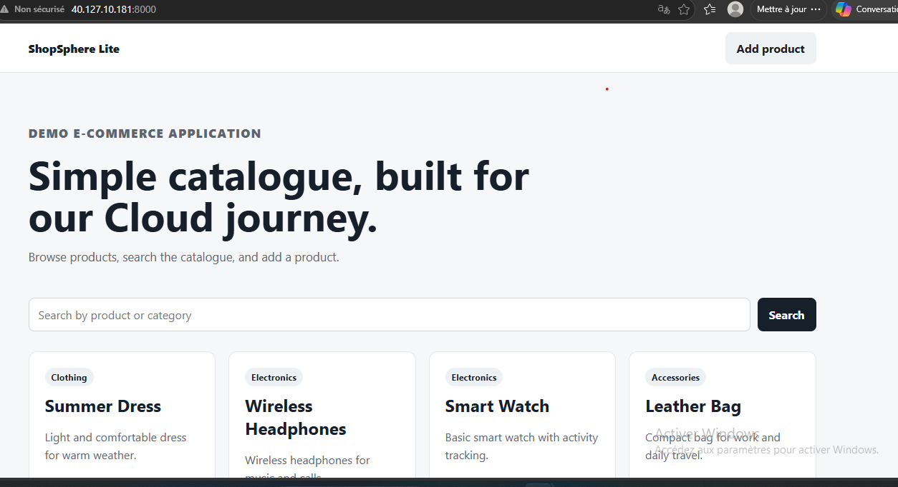

# ShopSphere Lite — Déploiement d’une application e-commerce sur Microsoft Azure

<p align="center">
  <strong>Cloud Engineering Journey | Microsoft Azure</strong>
</p>

⸻

## 1. Présentation du projet

ShopSphere Lite est un projet pratique réalisé dans le cadre de mon parcours d’apprentissage du Cloud Computing et de Microsoft Azure.

L’objectif était de déployer une application e-commerce existante, développée avec Python et Flask, sur une infrastructure cloud hébergée dans Microsoft Azure.

Mon travail a principalement porté sur la préparation de l’infrastructure, le déploiement de l’application sur une machine virtuelle Linux, la configuration du réseau et le provisionnement des services Azure associés.

Ce projet m’a permis de découvrir concrètement les différentes composantes d’une infrastructure cloud et leurs rôles dans l’hébergement d’une application.

État du projet : le déploiement a été réalisé et testé. L’environnement Azure est actuellement suspendu à la suite de l’expiration de mon abonnement d’essai. Les informations et captures présentées dans ce dépôt documentent la configuration réalisée pendant le projet.

## 2. Objectifs

* Déployer une application Flask sur une machine virtuelle Linux dans Azure.
* Configurer un réseau virtuel et ses sous-réseaux.
* Contrôler les accès réseau avec un Network Security Group (NSG).
* Découvrir le fonctionnement d’Azure SQL Database.
* Provisionner un compte Azure Storage.
* Comprendre les flux de communication entre les composants d’une infrastructure cloud.
* Acquérir une expérience pratique de l’administration d’une infrastructure Azure.

## 3. Technologies et services utilisés

| Technologie / Service | Utilisation |
| --- | --- |
| Microsoft Azure | Plateforme cloud |
| Ubuntu Server 24.04 LTS | Système d'exploitation de la VM |
| Python | Langage utilisé par l'application |
| Flask | Framework de l'application existante |
| Gunicorn | Serveur WSGI |
| Azure Virtual Machines | Hébergement de l'application |
| Azure Virtual Network | Organisation du réseau |
| Network Security Group | Filtrage du trafic réseau |
| Azure SQL Database | Service de base de données provisionné |
| Azure Storage | Service de stockage provisionné |

## 4. Architecture de l’infrastructure

L’infrastructure a été organisée autour d’un groupe de ressources Azure nommé ShopSphere-Lite.

Elle comprend une machine virtuelle Linux, un réseau virtuel, un Network Security Group, une base Azure SQL Database et un compte Azure Storage.

### 4.1. Vue générale de l’architecture

Le parcours principal d’une requête vers l’application est le suivant :

```text

                      UTILISATEUR
                       |
                       v
                    INTERNET
                       |
                       v
              ADRESSE IP PUBLIQUE
                       |
                       v
             INTERFACE RÉSEAU (NIC)
                       |
                [ NSG associé ]
                       |
                       v
             SHOPSPHERE-LITE-VNET
                  10.0.0.0/16
                       |
                       v
                   subnet-web
                  10.0.1.0/24
                       |
                       v
               VIRTUAL MACHINE
                Ubuntu Server
                  10.0.1.4
                       |
                       v
                   GUNICORN
                  Port 8000
                       |
                       v
               APPLICATION FLASK
Les services de données provisionnés dans le cadre du projet sont présentés séparément :

                SERVICES DE DONNÉES AZURE
                  AZURE SQL DATABASE
                         |
                         v
                    ShopSphereDB
                   AZURE STORAGE
                         |
                         v
                shopspherestoragefr
```
Remarque : la présence de ces ressources dans Azure est confirmée. Leur intégration effective dans le code de l’application et les chemins de communication correspondants ne sont pas documentés comme des connexions validées.

### 4.2. Organisation des ressources Azure

## Ressources Azure

| Ressource | Nom | Fonction |
| --- | --- | --- |
| Resource Group | ShopSphere-Lite | Regroupement des ressources |
| Virtual Network | ShopSphere-Lite-VNet | Organisation du réseau |
| Virtual Machine | ShopShere-Lite-VM | Hébergement de l'application |
| NSG | ShopSphere-Lite-VM-NSG | Filtrage du trafic |
| Azure SQL | ShopSphereDB | Base de données |
| Storage Account | shopspherestoragefr | Stockage |

Le nom ShopShere-Lite-VM reprend volontairement l’orthographe exacte enregistrée dans Azure.

### 4.3. Région Azure

Les ressources principales du projet ont été déployées dans la région :

South Africa North

### 4.4. Réseau virtuel (Virtual Network)

Le réseau virtuel ShopSphere-Lite-VNet possède l’espace d’adressage suivant :

10.0.0.0/16

Il est organisé en deux sous-réseaux :

| Sous-réseau | Plage d’adresses |
| --- | --- |
| default | `10.0.0.0/24` |
| subnet-web | `10.0.1.0/24` |

La machine virtuelle est déployée dans le sous-réseau subnet-web.

#### Vue d’ensemble du réseau virtuel


#### Configuration des sous-réseaux


### 4.5. Machine virtuelle Linux

La machine virtuelle héberge l’application Flask.

| Propriété | Configuration |
| --- | --- |
| Nom | `ShopShere-Lite-VM` |
| Système d'exploitation | Ubuntu Server 24.04 LTS |
| Taille | Standard B2als v2 |
| Processeurs virtuels | 2 |
| Mémoire RAM | 4 Gio |
| Zone de disponibilité | Zone 1 |
| Adresse IP privée | `10.0.1.4` |
| Réseau virtuel | `ShopSphere-Lite-VNet` |
| Sous-réseau | `subnet-web` |

#### Configuration de la machine virtuelle


### 4.6. Network Security Group (NSG)

Le Network Security Group ShopSphere-Lite-VM-NSG permet de contrôler les flux réseau entrants et sortants associés à l’interface réseau de la machine virtuelle.

Les principales règles entrantes configurées sont :

| Priorité | Nom de la règle | Port | Protocole | Source | Action |
| --- | --- | --- | --- | --- | --- |
| 1000 | `default-allow-ssh` | 22 | TCP | Adresse IP spécifique | Allow |
| 1100 | `allow-shopsphere-8000` | 8000 | TCP | Any | Allow |

Interprétation des règles :

* Le port 22 autorise l’administration de la machine virtuelle via SSH depuis une adresse IP spécifique.
* Le port 8000 autorise le trafic destiné à l’application depuis toutes les sources.

Le NSG était associé à l’interface réseau de la VM et non directement au sous-réseau.

Cette configuration correspond à un environnement de laboratoire. Dans un environnement de production, il serait préférable de restreindre davantage les accès, de mettre en place HTTPS et d’utiliser une configuration de reverse proxy adaptée.

### Règles du Network Security Group


## 5. Flux de communication

Cette section décrit le chemin suivi par les requêtes et le rôle des différents composants.

### 5.1. Accès utilisateur à l’application

Lorsqu’un utilisateur souhaite accéder à ShopSphere Lite :

1. Il ouvre son navigateur et envoie une requête vers l’adresse IP publique de la machine virtuelle.
2. Le trafic arrive sur l’interface réseau de la VM.
3. Le Network Security Group vérifie les règles applicables.
4. Si le trafic est autorisé, il peut atteindre le service qui écoute sur le port 8000.
5. Gunicorn reçoit la requête HTTP.
6. Gunicorn transmet la requête à l’application Flask.
7. Flask traite la demande et génère une réponse.
8. La réponse est renvoyée au navigateur de l’utilisateur.

### 5.2. Rôle des composants dans le flux

| Étape | Composant | Fonction |
| --- | --- | --- |
| 1 | Utilisateur | Initie la requête |
| 2 | Internet | Transporte le trafic |
| 3 | Adresse IP publique | Permet l’accès externe à la VM |
| 4 | NSG | Filtre le trafic réseau |
| 5 | NIC | Connecte la VM au réseau |
| 6 | Virtual Network | Fournit l’environnement réseau privé |
| 7 | Subnet | Contient la machine virtuelle |
| 8 | VM Linux | Héberge les services |
| 9 | Gunicorn | Reçoit les requêtes et les transmet à Flask |
| 10 | Flask | Traite les requêtes de l’application |

### 5.3. Communication avec Azure SQL Database

Une base Azure SQL Database a été provisionnée dans le cadre du projet.

| Propriété | Configuration |
| --- | --- |
| Base de données | `ShopSphereDB` |
| Serveur SQL | `shopsphere-sql-fr-2026` |
| Région | South Africa North |
| Niveau tarifaire | General Purpose – Serverless |
| Génération | Gen5 |
| Capacité | 1 vCore |
| Stockage maximal | 32 Go |

Si l’application est configurée pour utiliser cette base, le flux de communication est le suivant :
```text
APPLICATION FLASK
       |
       | Connexion SQL
       v
SERVEUR AZURE SQL
       |
       v
SHOPSPHEREDB
```
La connexion dépend de la chaîne de connexion, de l’authentification et des règles réseau configurées sur le serveur SQL.

L’intégration effective de cette base dans l’application n’étant pas confirmée, ce flux représente le fonctionnement attendu et non une connexion validée.

### Configuration Azure SQL Database


### 5.4. Compte Azure Storage

Un compte de stockage Azure a également été provisionné.

| Propriété | Configuration |
| --- | --- |
| Nom | `shopspherestoragefr` |
| Type de compte | StorageV2 |
| Performance | Standard |
| Réplication | LRS |
| Niveau d’accès Blob | Hot |
| Région | South Africa North |
| Version TLS minimale | 1.2 |
| Accès anonyme aux blobs | Désactivé |

Le compte Azure Storage permet notamment de stocker des objets tels que des images et des fichiers.

Si l’application est configurée pour utiliser ce service, le flux pourrait être :

```text
APPLICATION FLASK
       |
       v
AZURE STORAGE
       |
       v
COMPTE DE STOCKAGE
       |
       v
CONTENEUR BLOB
```

L’utilisation effective de ce compte par l’application n’est pas confirmée dans cette documentation.

### Configuration du compte Azure Storage


## 6. Déploiement et vérifications

Le travail réalisé dans le cadre de ce projet a notamment porté sur :

* La création et l’organisation des ressources dans un groupe de ressources Azure.
* Le déploiement d’une machine virtuelle Linux.
* La configuration du réseau virtuel et des sous-réseaux.
* La configuration du Network Security Group.
* Le déploiement de l’application Flask sur la machine virtuelle.
* L’utilisation de Gunicorn pour servir l’application.
* Les vérifications de connectivité et d’accessibilité de l’application pendant le déploiement.

### Application déployée



## 7. Sécurité et réseau

Plusieurs paramètres de sécurité ont été configurés ou observés dans Azure :

* Accès SSH limité à une adresse IP spécifique.
* Accès anonyme aux blobs désactivé.
* Version TLS minimale du compte de stockage fixée à 1.2.
* Transfert sécurisé requis pour les opérations API REST du compte de stockage.
* Démarrage sécurisé et vTPM activés sur la machine virtuelle.

Certaines configurations pourraient être renforcées pour un environnement de production :

* Restreindre l’exposition du port 8000.
* Mettre en place HTTPS.
* Utiliser un reverse proxy.
* Renforcer la gestion des identités et des autorisations.
* Étudier l’utilisation de points de terminaison privés pour les services de données.

## 8. Difficultés et apprentissages

Ce projet m’a permis de mieux comprendre les différentes composantes d’une infrastructure cloud et leur interaction.

J’ai notamment travaillé sur :

* L’organisation des ressources Azure.
* La configuration d’un réseau virtuel.
* La segmentation d’un espace d’adressage avec des sous-réseaux.
* Le contrôle du trafic avec un Network Security Group.
* Le déploiement d’une application sur une machine virtuelle Linux.
* Le rôle d’un serveur WSGI comme Gunicorn.
* La découverte des services Azure SQL Database et Azure Storage.
* La compréhension du chemin parcouru par une requête entre Internet et une application hébergée dans le cloud.

Ce projet m’a également permis de mieux comprendre le travail réalisé après le développement d’une application : son hébergement, son accessibilité et la gestion de l’infrastructure qui la supporte.

## 9. Limites et évolutions possibles

L’environnement Azure est actuellement suspendu à la suite de l’expiration de l’abonnement d’essai.

Le projet constitue donc une expérience de déploiement documentée, mais l’infrastructure n’est pas présentée comme actuellement opérationnelle.

Les évolutions possibles comprennent :

* Renforcer la sécurité du réseau.
* Configurer HTTPS et un reverse proxy.
* Améliorer la gestion des identités et des autorisations.
* Mettre en place Azure Monitor et des alertes.
* Étudier les stratégies de sauvegarde et de résilience.
* Automatiser le provisionnement de l’infrastructure.
* Approfondir la gestion des coûts et la gouvernance Azure.

## 10. Parcours Cloud Engineering

ShopSphere Lite fait partie de mon parcours personnel d’apprentissage de Microsoft Azure.

À travers ce projet, je souhaite développer progressivement mes compétences en :

* Cloud Computing.
* Administration systèmes Linux.
* Réseaux et sécurité.
* Gestion des infrastructures cloud.
* Supervision et automatisation informatique.

⸻

Auteur

Francesca YETO

Cloud Engineering Journey — Microsoft Azure

GitHub : FrancescaYE
